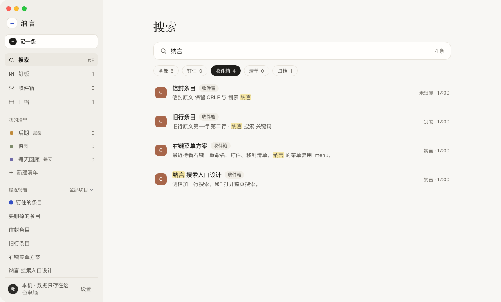

# 纳言 NaYan

> **值得的话，值得一个去处。**

**NaYan（纳言）是一款 macOS 桌面应用：一个专门用来捕捉、保存、整理「有价值的建议」的本地收件箱。**

它收集的对象很具体：你和各种 AI 助手工作时，它们说过的那些话——一个真正点醒你的提醒、一段恰到好处的分析、一条「这里有个坑」的警告。它们出现在 AI 编程助手的会话窗口里、网页里、任何 App 的文字里。

它的工作方式是一条流水线：**捕捉 → 收件箱 → 整理 → 执行**。从任何地方接住一句话，让它安静地躺在收件箱里，等你有空的时候整理归位，等你决定的时候变成行动。

它不是笔记软件，不是 Todo，也不是剪藏夹。它只认真做一件事：**把「建议」这一种东西收纳好。**



## 主要功能

- **收件箱**：一条一条排队进来；看的时候一次只有一条被照亮。没有红点催你，没有进度条逼你。
- **钉板**：把今天就要动手的那几条钉在最顺手的地方。
- **我的清单**：按主题自建清单，每条建议放进一个清单；清单可以设「每天回顾」或「到日期提醒」。
- **同题对比**：同一个问题问过好几个 AI？把它们收进同一组，逐条对照要点，还可以生成综合结论。
- **排成清单**：一段话里混着「待办 + 时间」？一键拆成带时间与状态的步骤（⌘⏎）。
- **搜索**：多关键词 AND、标题优先、命中高亮；⌘F 直达。
- **到期提醒**：给建议设一个「什么时候再看我」，到点在首页提醒。

## 四种收录方式

| 方式 | 怎么用 | 说明 |
| --- | --- | --- |
| 划词快记 | 选中文字按 **⌥⇧S** | 弹出小窗确认，起短标题后入箱；快捷键可在设置里自定义 |
| 框选识别 | **⌥⇧X** 框选屏幕区域 | 保存区域原图 + OCR 识别文字，原文可搜索 |
| 剪贴板监听 | 设置里开启 | 后台监听复制（可配置降噪名单），默认关闭 |
| 外部通道 | MCP / 浏览器扩展 / 快捷指令 | 让 AI 工具和自动化直接写入，见下文「MCP 接入」 |

每一条记录都带着来源（哪个 App、哪个窗口、哪个会话），随时可以回到它出生的地方。

## 安装

### 下载预览版

到 [Releases](https://github.com/joey08121112-web/nayan/releases) 下载 `NaYan-0.3.0.dmg`，打开后把纳言拖进「应用程序」。需要 macOS 13 或更新、Apple 芯片的 Mac。

预览版**还没有经过苹果公证**，第一次打开会被系统拦下：
1. 双击纳言，出现提示后点「完成」。
2. 打开「系统设置 › 隐私与安全性」，拉到底部，点「仍要打开」，输入密码。

也可以在终端运行：

```bash
xattr -dr com.apple.quarantine /Applications/NaYan.app
```

预览版用的是临时签名，换新版本后，系统可能要你重新授予「辅助功能」和「屏幕录制」。

### 从源码构建

需要：macOS 13+（Apple 芯片；Intel 未测试）、Xcode Command Line Tools、Rust（rustup）、Node.js 20+。

```bash
git clone https://github.com/joey08121112-web/nayan
cd nayan/app
npm install
npx tauri build
```

产物在 `app/src-tauri/target/release/bundle/`：`dmg/NaYan_*.dmg` 可以分发给别人，`macos/NaYan.app` 拖进 `/Applications` 即可。

日常自用开发机可以一键「构建 + 替换安装 + 启动」：

```bash
bash app/deploy.sh
```

## 需要的系统权限

| 权限 | 用在哪 | 不给会怎样 |
| --- | --- | --- |
| 辅助功能（Accessibility） | 划词时读取选中内容与来源窗口 | 划词收录不可用，其余功能正常 |
| 屏幕录制（Screen Recording） | 框选截图与 OCR | 框选收录不可用，其余功能正常 |

首次使用对应功能时系统会弹授权引导。剪贴板监听不需要额外系统权限，且默认关闭。

## 「AI 来源」三档与隐私

纳言是一个**本地优先**的应用：你的所有数据都存在本机 SQLite 里（`~/Library/Application Support/com.nayan.app/inbox.db`），不上传、不联网同步。

AI 是**可选增强**，默认关闭。设置里分三档：

1. **不用 AI（默认）**：所有功能都有不靠 AI 的做法——拆步按文本规则、对比按段落并排、标题按首句规则截断。
2. **自己的 Key**：填自己的 API Key 直连（DeepSeek / 智谱 / OpenAI 兼容接口均可，也支持本机 Ollama 的 base_url）。Key 只存在本机配置里，请求由 App 直接发给所选服务。
3. **纳言订阅**：官方托管，尚未推出。

开启后每个用 AI 的地方（拆步 / 对比 / 计划 / 起标题）还有单独开关；发送前会明确提示。

完整的隐私说明（数据放在哪里、什么时候联网、哪些端口只在本机）见 [PRIVACY.md](PRIVACY.md)。

## MCP 接入

把收件箱接给你的 AI 编程助手（stdio 传输，零依赖）：

```bash
node mcp-server.js   # 仓库根目录
```

提供 7 个工具：`add_suggestion`（写入一条）、`add_suggestions`（批量）、`list_suggestions`（读回，开工前让 AI 接着上次继续）、`update_suggestion`（改状态）、`set_steps` / `add_step` / `update_step`（步骤清单）。

Claude Code 全局接入示例（把路径换成你的克隆位置）：

```bash
claude mcp add --scope user suggestion-inbox -- node "/path/to/nayan/mcp-server.js"
```

Codex CLI（`~/.codex/config.toml`）：

```toml
[mcp_servers.suggestion-inbox]
command = "node"
args = ["/path/to/nayan/mcp-server.js"]
```

浏览器扩展在 `extension/`（Chrome MV3）：装上后在网页上划词/框选，经本机同步服务（`sync-server.js`，默认 8787 端口）写入收件箱。

## 开发与测试

```bash
# 一键跑全部测试（cargo + 全部 node 套件，与 scripts/test-baseline.json 对账）
node scripts/test-all.mjs

# 只跑几项
node scripts/test-all.mjs --only dom,real-app-v4

# Rust 侧单独跑
cd app/src-tauri && cargo test

# 单个渲染套件（证据默认写系统临时目录，不弄脏仓库）
node tests/renderer/dom.test.mjs
```

测试体系说明：渲染/UI 断言用真实产物（真实 `index.html`、真实 Rust 后端、无头 Chrome），不是 mock 拼盘；外部写入方（MCP / 同步服务）有独立的全矩阵套件。详见 `CONTRIBUTING.md`。

## 目录结构

```
app/            桌面应用（Tauri v2：app/ui 前端 + app/src-tauri Rust 后端）
extension/      Chrome 浏览器扩展
mcp-server.js   MCP 服务器（AI 工具接入）
sync-server.js  扩展/快捷指令的本机写入服务（HTTP）
schema-gate.mjs 外部写入方的 schema 门控（与 Rust 迁移同口径）
site/           官网静态页
tests/          测试（渲染 / 收录 / 摄取 / 迁移 / reader 回归）
scripts/        test-all.mjs 等工程脚本
```

## License

MIT —— 见 [LICENSE](LICENSE)。

## English Summary

NaYan is a local-first macOS inbox for **valuable suggestions**: the genuinely useful things AI assistants (or any app, any webpage) say to you during the day. Capture via text selection (**⌥⇧S**), screen-region OCR (**⌥⇧X**), optional clipboard watching, or external channels (MCP server, browser extension, Shortcuts). Everything is stored in a local SQLite database — no cloud, no sync. AI features (step splitting, multi-answer comparison, titling) are optional enhancements with a no-AI path for everything, using your own API key if you opt in. Built with Tauri v2 (Rust + vanilla JS). MIT licensed.
